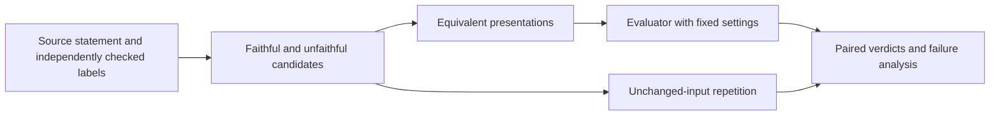

# formalization-eval-robustness

Research design for testing whether mathematical semantic evaluators give stable
verdicts when a formal statement's presentation changes but its meaning does not.

**Public status: documentation scaffold.** This branch contains the research
question and a proposed artifact structure. It does not contain a runnable
evaluator, transformation generator, proof certificates, datasets, tests or
experimental results. There is no reproduction command or measured result to
report from this public repository.

## The question in one example

Suppose a source statement asks for a real number strictly between 0 and 10.

| Candidate | Relationship to the source |
|---|---|
| `x > 0 ∧ x < 10` | Faithful to the stated condition |
| `x < 10 ∧ x > 0` | Same meaning, reordered presentation |
| `x > 0` | Unfaithful: the upper bound is missing |
| `0 < x` | Equivalent to the unfaithful candidate; still missing the upper bound |

The value `x = 12` distinguishes the last two candidates from the source.
An evaluator should preserve its verdict across equivalent presentations of each
candidate, while still distinguishing faithful and unfaithful candidates.

This is an illustrative logic example, **not an experiment or a machine-checked
certificate**. It also shows why two questions must be kept separate:

1. Does a transformation preserve the candidate's mathematical meaning?
2. Does that candidate preserve the original source's meaning?

Proving the first does not prove the second.

## Proposed evaluation approach

The design compares transformed candidates with unchanged-input repetition.
That control matters: an evaluator can disagree with itself even when its input
does not change. Any future search over presentations should use matched call
budgets and separate selection from fresh confirmation.

The intended evidence is inspectable: source statements, independent labels,
exact candidate text, transformation checks, evaluator settings, raw responses,
parsing decisions and analysis code. Failed or unscored calls should be visible
rather than silently removed. These are design goals, not implemented features
of this branch.

## Repository map

Each directory currently contains documentation only.

| Location | Intended role |
|---|---|
| [baseline/](baseline/README.md) | Pin and describe the evaluator being tested |
| [examples/](examples/README.md) | Source statements, candidates and label evidence |
| [transformations/](transformations/README.md) | Meaning-preserving rewrites and their checks |
| [experiments/](experiments/README.md) | Controls, budgets and execution protocol |
| [patches/](patches/README.md) | Separately documented implementation corrections |
| [scripts/](scripts/README.md) | Reproduction and validation entry points |
| [results/](results/README.md) | Evidence and limitations of completed public runs |
| [notes/](notes/research-log.md) | Public status and research decisions |

## What a substantive release would need

- A versioned baseline with provenance and a runnable offline check.
- At least one independently justified faithful/unfaithful example pair.
- Transformation checks bound to the exact evaluated candidate text.
- A documented protocol that distinguishes random variation, implementation
  errors and presentation sensitivity.
- Raw outputs, analysis and a reproducible report with explicit scope limits.

No novelty claim, evaluator ranking or general failure-rate estimate is made
here.

## Related work in this portfolio

[Math Reward Hacking](https://github.com/nealyx/math-reward-hacking) is a separate,
completed arithmetic evaluation case study with public saved-output
reproduction. It examines reward and answer-extraction measurement; its findings
are not results for this proposed formalization study.
